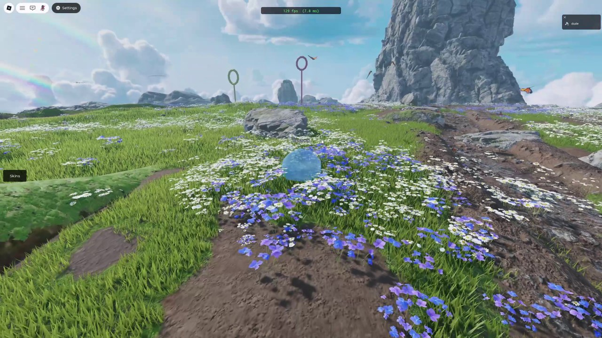
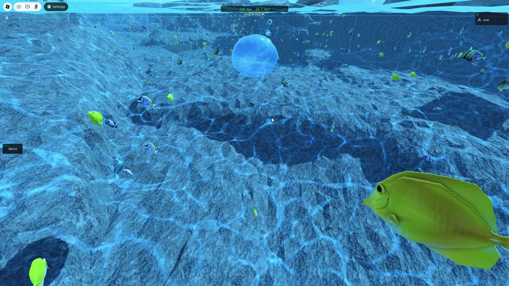
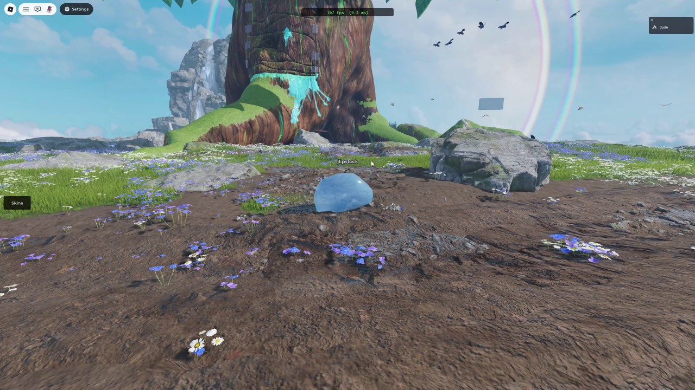
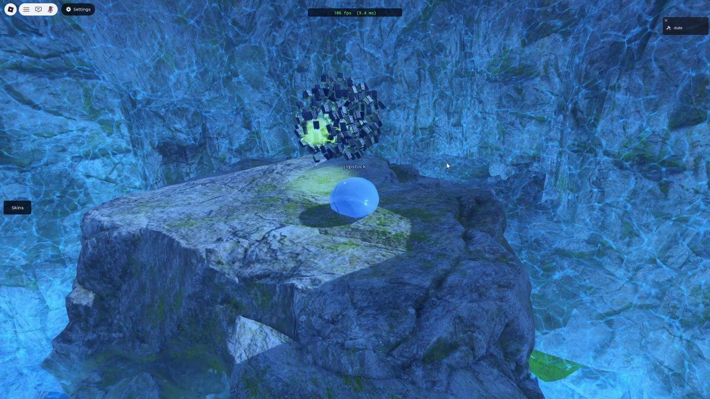
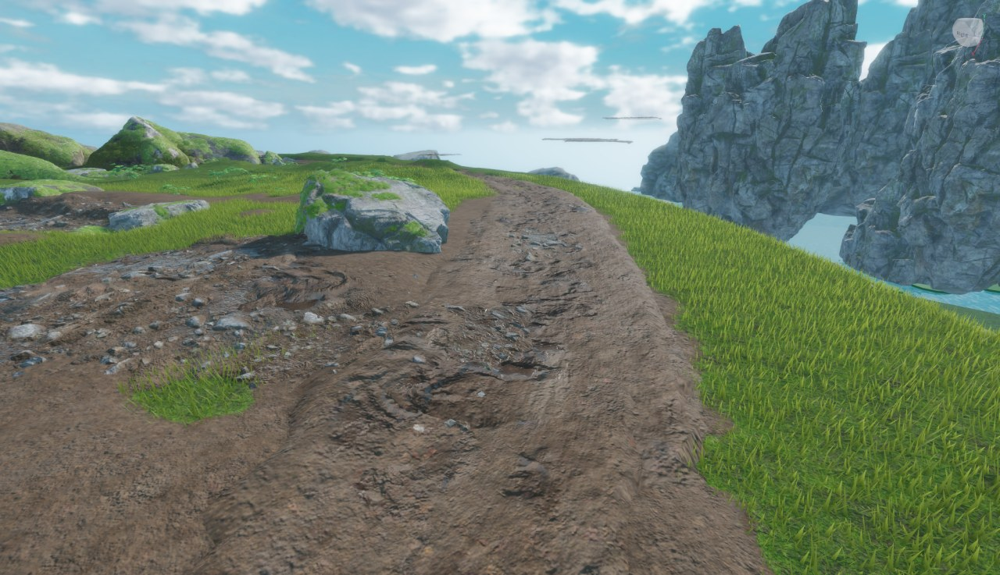
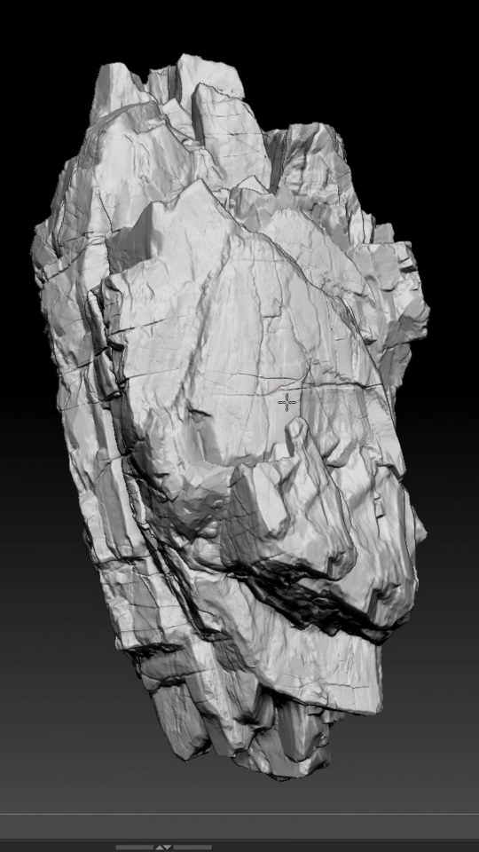

# Slime World: a film-quality world on Roblox

A Roblox game where you play a squishy slime ball rolling, bouncing and swimming through a hand-built world:
flower meadows, giant trees, rock spires, caves, and an underwater reef full of fish. The aim was to bring **film
VFX environment quality to a platform that runs on phones**.

https://github.com/user-attachments/assets/7b58aaf7-c301-411f-8713-f3a0fc572643

<i>Diving in: the custom water surface, animated caustics on the rocks, and a fish school passing.
The counter at the top of each clip is the in-game FPS overlay (desktop capture, 1440p).</i>

I'm a VFX artist. I built the world myself: I modeled in Maya, sculpted in ZBrush, textured in Substance,
scattered inside Roblox, and used Houdini for collision creation. I made the game's tech by **directing AI coding agents**. Most of that tech is the
[Roblox Studio tools](https://github.com/jlipstock/roblox-studio-tools) I built for it.

> The source is private. This page describes the game and how it was made.

<table><tr><td width="50%"></td><td width="50%"></td></tr><tr><td width="50%"></td><td width="50%"></td></tr></table>

<i>In-game captures. Top: the meadow (the counter in the corner reads 129 fps). Then the underwater reef with
caustics and a fish school, a flock of birds under the giant tree, a cave, and a terrain path.</i>

## What's in it

- **The slime**: a squishy slime-ball character controller (rolling, jumping, swimming) that reshapes to
  different slime skins, with a skin picker.
- **Water**: custom displaced water surfaces you can swim through, with animated caustics on the rocks below.
- **Life**: fish schools that shoal and steer around the player, and bird flocks that take off, glide and land.
- **Dressing**: painted flower fields and foliage that sway as you move through them, culled by distance so phones
  keep up.
- **Atmosphere**: world and zone fog, colour zones for per-area grading, and wind streaks.
- **Performance tooling**: an in-game FPS overlay for phones and stutter diagnostics, used to hold 60 fps on real
  devices.

## In motion

**Dressing: flower fields.** Scattered flowers and grass that react as the slime rolls through them.

https://github.com/user-attachments/assets/c16773ab-44e2-4442-9a58-04eab625d7b2

**Life: the reef.** Several fish species schooling and steering around the player.

https://github.com/user-attachments/assets/64f909ea-a1c2-4a45-a753-33218e587606

**Atmosphere: colour zones.** The grade shifts from daylight to blue on the way into the cave.

https://github.com/user-attachments/assets/a7865bd6-5de2-49be-b674-ee530ae4b53d

**Meadow to shoreline.** Grass, flowers and paths running down to the water.

https://github.com/user-attachments/assets/0da66a36-7419-466e-ade0-b19304bcf653

## The art

<i>One of the rock cliff assets, sculpted in ZBrush before texturing and baking down for Roblox.</i>

The environment came out of a full VFX pipeline: Maya models, ZBrush sculpts, Substance textures and Houdini
collision, plus Marmoset and Nuke. Everything was then baked down to fit Roblox's
mesh, texture and part budgets.

## Tech

Luau · Roblox Studio · EditableMesh · ZBrush · Substance · Maya · Houdini · Marmoset · Nuke
